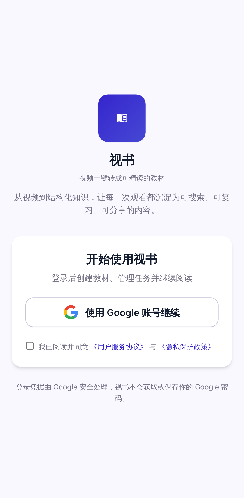
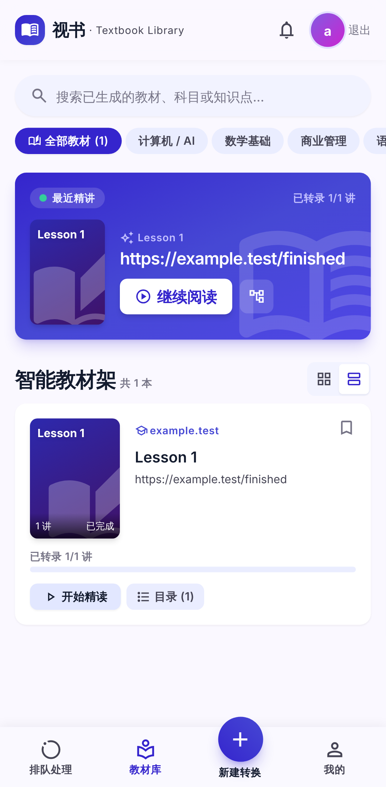
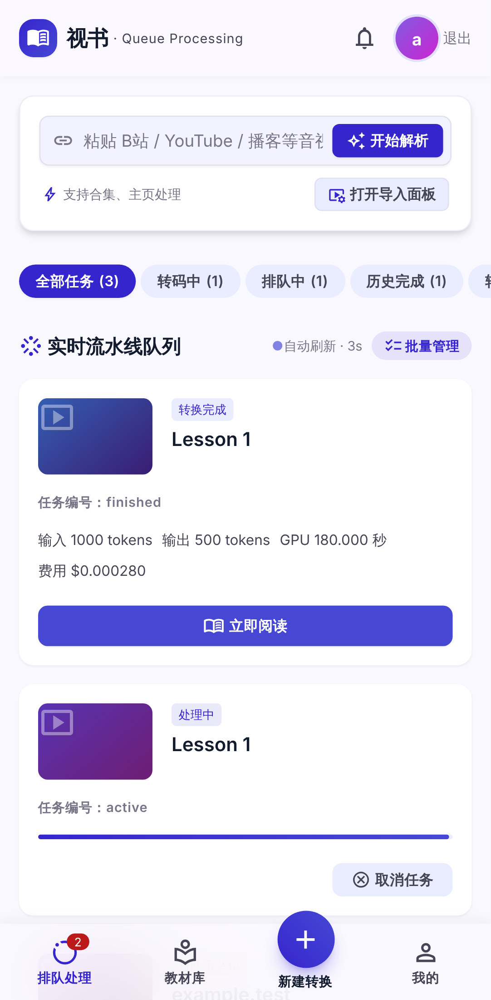
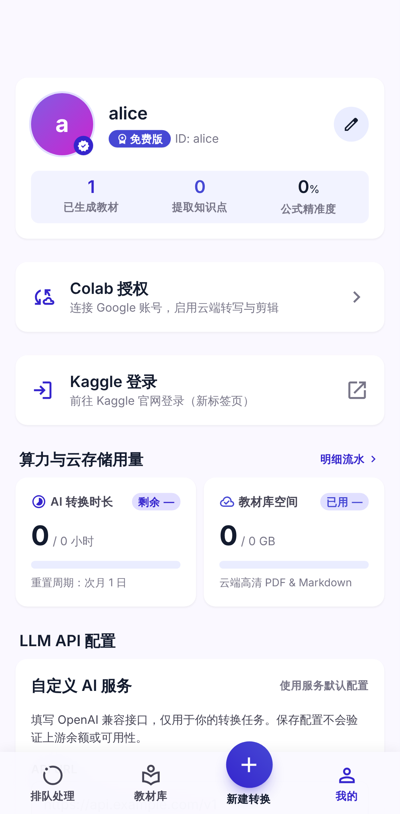

# 视书 · Web（frontend/web）

video2md 的移动端 Web 前端：Vue 3.5.43 + Vite 8.3.4 + TypeScript 6.0.3 + Tailwind CSS 3.4.19 + Pinia 2.3.1 + vue-router 4.6.4。
队列、教材库、阅读器、资料与配额全部走 FastAPI 真实接口；登录只提供 Google 授权码流。

| 品牌首页                                      | 教材库                                        | 转换队列                                      | 阅读器                                       | 我的                                        |
| --------------------------------------------- | --------------------------------------------- | --------------------------------------------- | -------------------------------------------- | ------------------------------------------- |
|  |  |  |  |  |

截图由 `npm run screenshots` 在真实 FastAPI 测试夹具上生成（数据为夹具预置任务）。

## 命令

依赖版本以 `package.json` 与 `package-lock.json` 的精确版本为准；安装一律使用 `npm ci`。

```bash
npm ci                   # 按 lockfile 安装依赖
npm run dev              # 开发服务器（http://localhost:5173，按 390px 移动视口设计）
npm run build            # vue-tsc 类型检查 + vite 生产构建 → dist/
npm run lint             # ESLint（Vue + TypeScript），警告也视为失败
npm run format           # Prettier 格式化；npm run format:check 只检查
npm run test:integration # Pinia → 真实 HTTP → FastAPI 集成测试（需 backend/.venv）
npm run test:regression  # 源码与评测集防回退检查（无需后端）
npm run test:e2e         # Playwright 浏览器端到端测试（需 backend/.venv 与 Chromium）
npm run screenshots      # 重新生成 docs/screenshots/*.png
npm run preview          # 预览构建产物
```

开发时用 `VITE_API_BASE_URL` 指向 FastAPI（默认 `http://127.0.0.1:8790`），后端需设置
`V2MD_CORS_ORIGINS=http://localhost:5173`。

## 测试

前置：Node 24+，仓根下 `cd backend && uv sync --frozen` 安装后端依赖。自定义 Python 环境可设
`V2MD_TEST_PYTHON=/absolute/path/to/python`。

- **集成测试**（`tests/*.integration.test.mjs`）：Node 内置测试运行器，通过 Vite 加载真实 TypeScript 模块。
  每次启动独立 FastAPI 子进程（`backend/tests/fixtures/web_integration_api.py`），监听随机回环端口，
  数据全部在临时目录内。只替换外部身份验签（固定 Alice/Bob 凭据），关闭 lifespan，不启动视频下载、GPU 或 LLM。
- **E2E**（`e2e/*.spec.ts`）：Playwright 在 Pixel 7 视口驱动真实浏览器，后端同样是上述夹具，
  覆盖登录（含 Google 回跳与过期凭据）、提交任务（复用、校验、预算拒绝）和阅读（带鉴权媒体、进度回写）。
  Google 授权页是唯一被拦截的外部依赖。本机已有 Chromium 时可设 `PW_CHROMIUM_PATH` 跳过下载。
- **防回退**（`tests/*.regression.test.mjs`）：执行 [`docs/evals/frontend-quality-eval-set.jsonl`](../../docs/evals/frontend-quality-eval-set.jsonl)
  中的每条用例，并验证每条用例的反例确实会被判定为失败。

CI（`.github/workflows/ci.yml` 的 `web-integration`）依次运行 lint、format:check、build、集成、防回退和 E2E。

## 行为约定

- 队列每 3 秒从后端轮询真实状态；取消、重试、优先执行、删除均通过 HTTP 持久化。
  取消是协作式终止，长阶段结束前显示「取消中」；重试只支持 error/partial，保留已完成笔记；
  优先执行只重排等待中的任务；删除要求终态，保留用户 vault 笔记及已结算用量。
- Markdown 原始包下载只在后端 deliver 模式且产物存在时显示（vault 模式笔记已直接写入 vault）；
  浏览器开始下载不等于用户已保存，因此不自动 ACK。
- 阅读器通过带 Bearer 鉴权的媒体接口获取图片/视频，渲染前经 DOMPurify 净化，只恢复自身创建的 `blob:` 地址；
  对象 URL 在切讲或卸载时释放。
- 界面不展示没有后端支撑的功能或模拟文案（支付、草稿、网盘/本地上传、Notion 同步等原型入口已移除），
  由防回退测试与 E2E 共同约束。

## 鉴权与路由

| 路由             | 页面               | 说明                                                                                                                                          |
| ---------------- | ------------------ | --------------------------------------------------------------------------------------------------------------------------------------------- |
| `/`              | 品牌首页与登录入口 | 协议同意后跳 `{API}/auth/google/login`；消费回跳 fragment `#id_token=` / `#auth_error=`，保留过期提示与安全站内回跳；不存在独立 `/login` 页面 |
| `/library`       | 教材库             | 搜索/分类/收藏夹过滤、继续阅读横幅、grid/list 视图、目录抽屉                                                                                  |
| `/read/:id`      | 阅读器             | 按讲渲染笔记，`?ch=N` 指定起始讲，切讲写回阅读进度                                                                                            |
| `/tasks`         | 转换队列           | 快速链接导入、导入面板、任务状态卡、批量管理、3s 后端状态轮询                                                                                 |
| `/profile`       | 个人中心           | 资料卡、配额与费用明细、Colab 授权入口、LLM API 配置                                                                                          |
| `/profile/colab` | Colab 授权         | 首次登录引导，可「稍后连接，继续使用」回到原目标页                                                                                            |

未登录访问受保护路由会跳 `/?redirect=…`；token 存 `localStorage['v2md_token']`，任一 API 返回 401 即清除并跳回品牌首页。
后端 `V2MD_AUTH=off`（仅开发）时无凭据 `GET /me` 返回 200，前端据此进入匿名模式。
生产由 FastAPI 同源托管本 bundle，前端路由不得与 API 路由重名（`GET /queue` 是 gpu_router 回读口，故队列页用 `/tasks`）；
`backend/tests/test_api_contract.py::test_spa_routes_serve_index_not_api` 校验这一点。

## LLM API 配置

「我的」页面可填写 OpenAI 兼容的 Base URL、API Key 和可选模型名，用于该用户之后启动的任务；运行中的任务保持启动时的配置。
Key 默认隐藏，保存后清空输入框，服务端读接口不返回 Key，浏览器不保存 Key；已有配置时 Key 留空可保留原值；
「恢复服务默认」删除个人配置并回落后端 `LLM_*`。保存只校验格式，不代表上游余额或连通性已验证。
接口为鉴权的 `GET/PUT/DELETE /settings/llm`，存储细节见 [HTTP 契约](../../docs/architecture/03-api-contract.md)。

## 目录

```
src/
├── api/          # client.ts（fetch + Bearer + 错误信封）与 live/*（各业务接口），index.ts 为唯一出口
├── stores/       # Pinia: auth / library / queue / profile / toast
├── composables/  # useCountdown 等无状态逻辑
├── components/   # common / book / queue / profile / art（本地渐变占位图形，零外链图片）
├── views/        # 页面
├── types/        # 与后端契约对齐的共享类型（docs/architecture/03-api-contract.md）
├── reader.ts     # 阅读器的章节与媒体工具函数
└── download.ts   # Markdown 原始包下载
e2e/              # Playwright 端到端测试与截图脚本
tests/            # Node 集成测试与防回退测试
```

Tailwind 主题（M3 色板/Inter/自定义间距）见 `tailwind.config.js`；图标使用 Material Symbols Outlined 字体（Google Fonts CDN，唯一外部依赖）。
